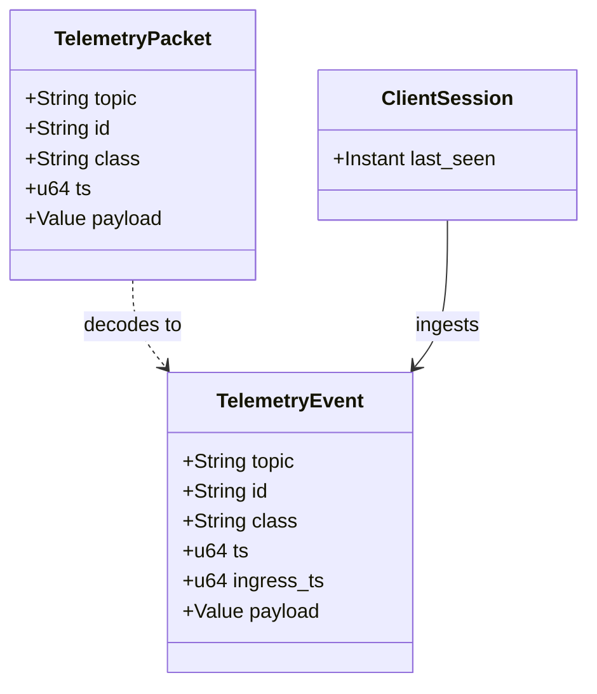
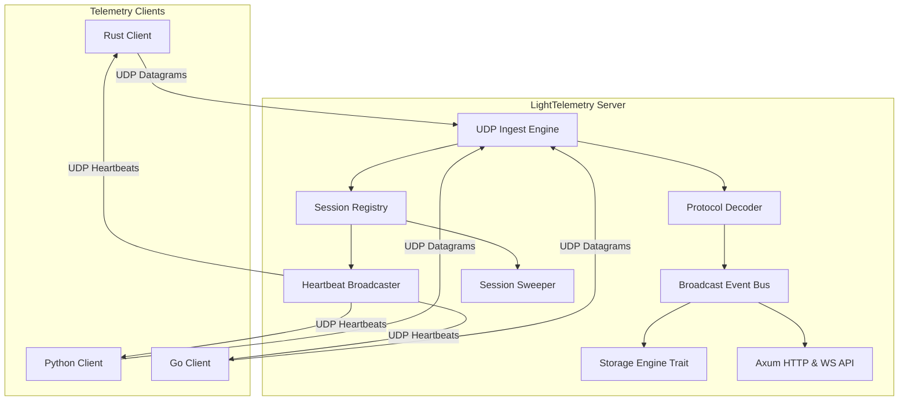
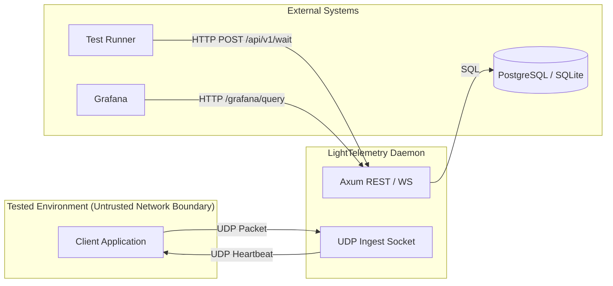
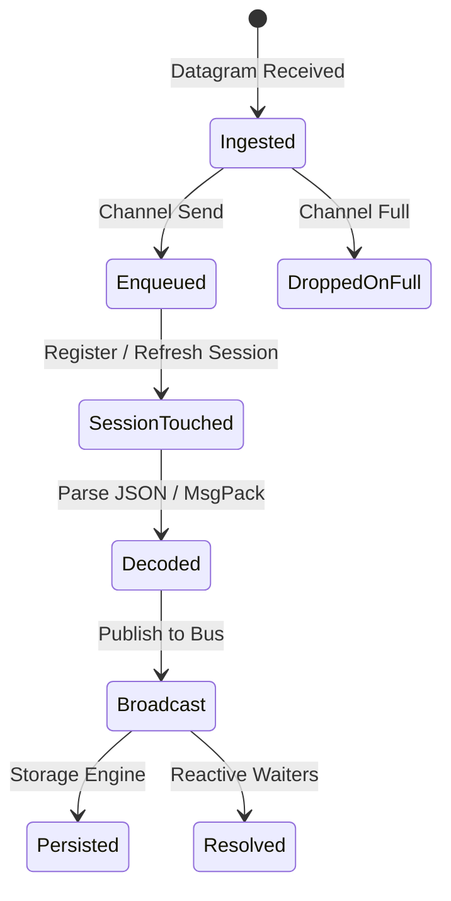
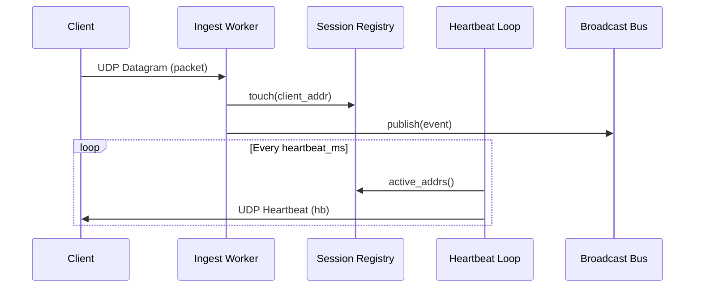
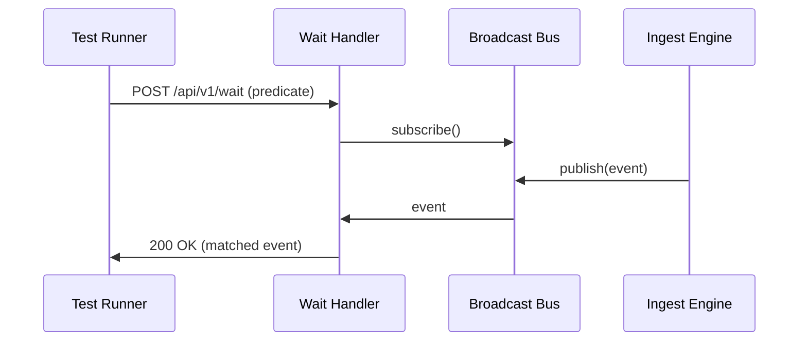

<!-- Generated: 2026-11-11 | Base commit: 7a2e0760802d529972b09076f59e90cab2323ad6 -->

# Project Architecture LightTelemetry

## 1. Overview & Domain Model

LightTelemetry aggregates events and metrics in automated testing environments.
It provides minimal client overhead via UDP fire-and-forget ingestion.
A reactive assertion API allows tests to wait for specific events without polling.
A reverse heartbeat mechanism lets clients detect server availability.

The primary domain entity is `TelemetryEvent`.
Clients emit `TelemetryPacket` structures over UDP.
The server receives raw datagrams, touches the sender session, and decodes datagrams into `TelemetryEvent` structures.

## 2. Component Architecture

The repository contains three primary layers:
1. `crates/server`: The ingest daemon, broadcast event bus, storage backends, and HTTP/WS API.
2. `crates/client`, `python/`, `go/`: Client libraries and logging facade adapters.
3. `spec/`: Golden wire vectors and JSON schemas defining the cross-language wire contract.

## 3. External Integrations & Trust Boundaries

The server exposes three network interfaces:
- UDP Ingest port (default `9876`): receives unauthenticated fire-and-forget datagrams.
- HTTP REST & WebSocket port (default `8080`): serves test assertions and event queries.
- Grafana Datasource adapter: serves metrics and table queries to Grafana dashboards.

External storage backends include local memory, SQLite, and PostgreSQL.

## 4. Data Flow, Concurrency & State Management

The data path uses bounded channels and non-blocking actors:
1. Socket pool workers receive datagrams and push them to a bounded `tokio::sync::mpsc` channel.
2. A single decode worker dequeues datagrams, touches the sender session, and decodes them into events.
3. The decode worker publishes each event to a `tokio::sync::broadcast` bus.
4. Storage tasks and active reactive wait queries subscribe to the broadcast bus.
5. `heartbeat_loop` periodically iterates registered sessions and sends heartbeats.
6. `sweeper_loop` evicts sessions older than `session_ttl_ms`.

## 5. Key Sequence Diagrams

### Event Ingest and Heartbeat Dispatch

### Reactive Assertion Wait (`POST /api/v1/wait`)

## 6. Architectural Invariants

| Invariant | Level | Verification Mechanism | Status |
| :--- | :--- | :--- | :--- |
| Ingest worker never blocks on slow consumer | Runtime | `mpsc::try_send` + drop metric | Enforced |
| Wire ingress timestamp overrides client timestamp | Runtime | `decode::decode` unit test | Enforced |
| Golden serialization test vectors match across languages | Build | `test_spec_vectors` in Rust/Python/Go | Enforced |
| Client emission never panics or blocks host caller | Runtime | `emit` unit test suite | Enforced |
| Heartbeat watcher operates on connected/bound client socket | Runtime | Unit and integration tests | Enforced |

## 7. Architectural Debt & Bottlenecks

- **Heartbeat Deadlock in Degraded Mode**: When a client enters degraded mode, it drops all emissions. If the server session TTL expires, the server drops the client from the active registry. The client never transmits another datagram, preventing session re-registration and locking the client in degraded mode permanently (`crates/client/src/lib.rs:170`, `python/light_telemetry/client.py:151`, `go/light-telemetry/telemetry.go:136`).
- **Parallel Global Metric Collision**: Unit tests that assert on global atomic metrics race when cargo tests run concurrently (`crates/server/src/ingest.rs:188`).
