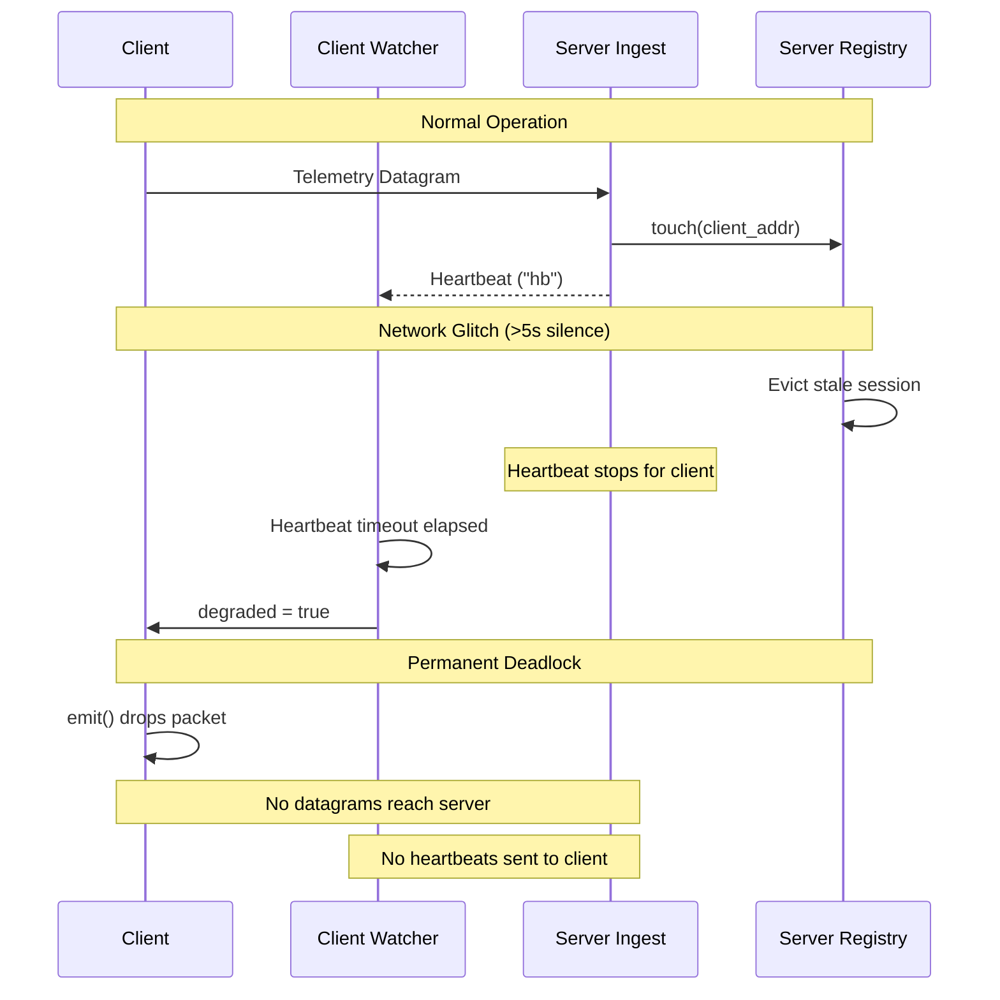
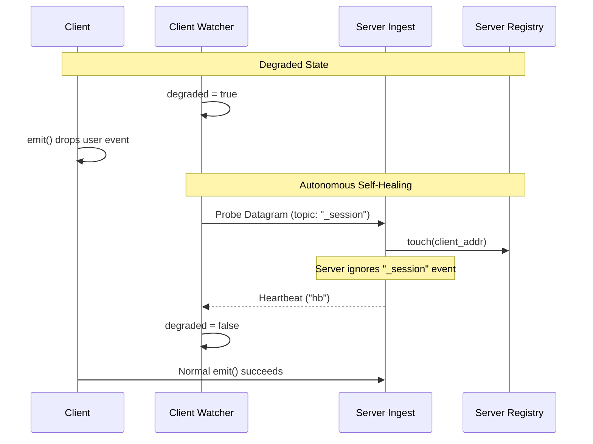

# Architecture Proposal: Self-Healing Liveness Gate
<!-- Link base: write relative links with the repository root as the base. -->

> **Note:** This proposal follows the workflow defined in [ARCHITECT.md](agentic/ARCHITECT.md).

- **Author:** Antigravity agent session
- **Created:** 2026-11-11
- **Status:** implemented
- **Implemented:** 2026-11-11

## 1. Summary

This proposal adds an autonomous keepalive probe to the client heartbeat watcher.
Clients periodically transmit a lightweight probe datagram while in degraded state.
The datagram refreshes the client session on the server.
The server resumes heartbeat transmission to the client address.
The client watcher receives the heartbeat and clears degraded mode automatically.
This behavior prevents permanent telemetry black-holes caused by transient packet loss.

## 2. Motivation

The client heartbeat liveness gate currently encounters permanent deadlock after transient packet loss.
The server evicts client sessions after five seconds of silence (`session_ttl_ms`).
When the server evicts a session, it ceases heartbeat transmission to that client.
The client detects three seconds of missing heartbeats and sets `degraded` to true.
The client `emit()` function drops all events while degraded.
Because the client drops all emissions, it sends zero datagrams to the server.
The server never refreshes the evicted session.
The client remains degraded permanently.
Downstream services like `k4dpi` work around this bug by disabling the watcher entirely.
This proposal resolves the defect and restores reliable liveness detection.
See [light-telemetry-feature-request.md](docs/requests/light-telemetry-feature-request.md) for background details.

## 3. Current Architecture

The client and server coordinate liveness through UDP datagrams.
Clients send `TelemetryPacket` datagrams over UDP.
The server decode task touches the sender address in `SessionRegistry` for every datagram.
The server `heartbeat_loop` sends heartbeats every second to active session addresses.
The client watcher marks the client degraded when heartbeats stop for three seconds.
The client `emit()` method drops packets immediately when degraded.

## 4. Proposed Changes

### Structural changes

Add autonomous probe scheduling to the heartbeat watcher thread and goroutine.
The watcher maintains a timer for keepalive probing.
The watcher holds the socket handle and target server address.
The watcher holds the client `host_id` and `host_class` values.

### Data and type changes

The wire protocol reserves the topic name `_session`.
Probes serialize as standard `TelemetryPacket` structures with topic `_session`.
The payload field is empty.
The server decodes the packet and touches the sender session.
The server ingest pipeline discards events with topic `_session` before publishing to the broadcast bus.

### Concurrency and state changes

The watcher thread tracks the last probe transmission time.
While `degraded` is true, the watcher sends one probe datagram per `heartbeat_timeout` interval.
Normal emission paths continue to drop user payloads before serialization when degraded.
Receipt of a server heartbeat clears the degraded flag and resets the probe timer.

### Integration changes

All three client implementations adopt identical probe behavior:
- Rust client (`crates/client/src/heartbeat.rs`)
- Python client (`python/light_telemetry/client.py`)
- Go client (`go/light-telemetry/heartbeat.go`)

## 5. Trade-offs

### Benefits

- **Deadlock removal:** Clients recover automatically from packet loss and server restarts.
- **Low emitter support:** Low-rate emitters remain registered without flapping degraded status.
- **Payload economy:** The client drops heavy user payloads during genuine server outages.
- **Protocol compatibility:** Existing server versions can parse `_session` datagrams without crashing.

### Costs and Risks

- **Network traffic:** Degraded clients send one datagram per three seconds per process.
- **Socket contention:** The watcher thread shares the UDP socket for writing probe datagrams.

### Alternatives Considered

- **Leaky emit gate:** Allow one user payload through every three seconds inside `emit()`. This alternative does not heal idle or low-rate emitters.
- **Bounded degraded timeout:** Clear degraded mode after a fixed duration. This alternative floods dead sinks with full batches of user payloads.
- **Explicit hello handshake:** Introduce dedicated client hello frames. This alternative requires breaking protocol additions across client and server.

## 6. Implementation Plan

Execute this change under the Standard change plan tier in `project/PLAN_self_healing_liveness_gate.md`.

### Phase 1: Server and Spec Updates
- **Goal:** Document the reserved `_session` topic and ignore it during server event broadcast.
- **Files to touch:**
  - `spec/schemas/packet.schema.json`
  - `crates/server/src/ingest.rs`
- **Approach:**
  - Update `crates/server/src/ingest.rs` to skip `bus.publish(ev)` when `ev.topic == "_session"`.
  - Add server tests verifying session touch on `_session` datagrams without bus publication.

### Phase 2: Rust Client Autonomous Probe
- **Goal:** Add probe transmission to the Rust heartbeat watcher.
- **Files to touch:**
  - `crates/client/src/heartbeat.rs`
  - `crates/client/src/lib.rs`
- **Approach:**
  - Pass `host_id`, `host_class`, and format flags to `spawn_watcher`.
  - Transmit `_session` datagram every `heartbeat_timeout` while `degraded` is true.
  - Add client unit tests verifying probe generation during degraded state.

### Phase 3: Python Client Autonomous Probe
- **Goal:** Add probe transmission to the Python client heartbeat watcher.
- **Files to touch:**
  - `python/light_telemetry/client.py`
  - `python/tests/test_client.py`
- **Approach:**
  - Update `_watch` in `client.py` to send `_session` datagrams while `_degraded` is set.
  - Add pytest tests for watcher self-healing.

### Phase 4: Go Client Autonomous Probe
- **Goal:** Add probe transmission to the Go client heartbeat watcher.
- **Files to touch:**
  - `go/light-telemetry/heartbeat.go`
  - `go/light-telemetry/telemetry_test.go`
- **Approach:**
  - Update `watch()` to send `_session` datagrams via `c.conn` on probe timeout.
  - Add Go tests for watcher self-healing.

## 7. Testing Strategy

### Unit tests
- Rust: `crates/client/src/heartbeat.rs` tests watcher probe emission and recovery.
- Python: `python/tests/test_client.py` tests watcher probe emission and recovery.
- Go: `go/light-telemetry/telemetry_test.go` tests watcher probe emission and recovery.
- Server: `crates/server/src/ingest.rs` tests `_session` topic filtering from the event bus.

### Integration tests
- Run end-to-end test simulating server session eviction and verify automatic recovery.
- Verify that storage engines store zero `_session` events.

### Invariant checks
- Invariant: Degraded clients send at most one probe datagram per `heartbeat_timeout` window.
- Invariant: User `emit()` calls drop immediately without serialization while degraded.
- Invariant: The server refreshes sessions on valid `_session` datagrams.
- Invariant: The server never forwards `_session` events to reactive assertion waiters or storage.

### Migration or rollback tests
- Ensure unpatched servers continue operating normally when receiving `_session` packets.
- Ensure unpatched clients continue operating with patched servers.

## 8. Open Questions

- **probe_interval configuration (non-blocking):** Should clients allow custom probe intervals or default strictly to `heartbeat_timeout`?
