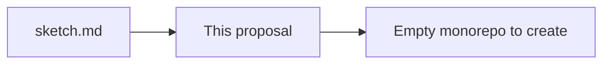
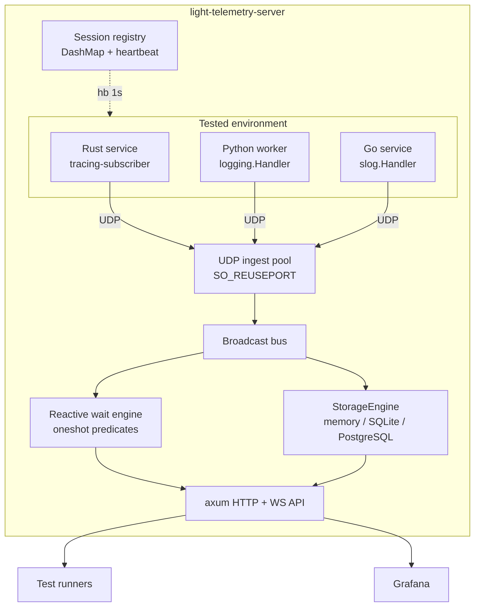

# Architecture Proposal: LightTelemetry Monorepo Bootstrap
<!-- Link base: write relative links with the repository root as the base. -->

> **Note:** This proposal follows the workflow defined in [ARCHITECT.md](agentic/ARCHITECT.md).

- **Author:** Alexey Sudachen
- **Created:** 2026-11-07
- **Status:** created
- **Implemented:** —

## 1. Summary

This proposal creates LightTelemetry as a greenfield polyglot monorepo in this repository. A Rust daemon receives telemetry datagrams over UDP from services under test. The daemon decodes each datagram, fans it out over a broadcast bus, and persists it in one of three pluggable storage engines. Client libraries for Rust, Python, and Go attach to each language's native logging facade. Test runners query events through REST endpoints or block on a reactive wait endpoint until a matching event arrives. Grafana reads events directly through a datasource adapter. The full design intent lives in [sketch.md](sketch.md).

## 2. Motivation

Automated tests need observability into the services they exercise. Existing stacks impose three costs on test environments.

- **Client overhead:** TCP shippers add connection state, buffering, and serialization cost to the tested service.
- **Assertion races:** Tests poll storage or call `sleep()` between a cause and its observable effect. Both approaches flake under load.
- **Dashboard lag:** Background indexers delay events before dashboards can render them.

LightTelemetry removes these costs. UDP fire-and-forget keeps client overhead near zero. A reverse heartbeat lets clients drop events before serialization when the server is absent. The `POST /api/v1/wait` endpoint resolves as soon as a matching event arrives. Grafana reads the in-memory buffer directly without an external database.

## 3. Current Architecture

The repository contains no code. It holds the agent workflow documents under `agentic/` and the design sketch at [sketch.md](sketch.md). This proposal defines the first architecture of the repository. All components below are new.



## 4. Proposed Changes

### Structural changes

Create a polyglot monorepo at the repository root. The remote identity is `github.com/oldienki/telemetry`.

```text
Cargo.toml                    # Cargo workspace: server + Rust clients
Cargo.lock
Justfile                      # Unified task runner
spec/                         # Cross-language contract (single source of truth)
├── schemas/packet.schema.json
├── schemas/heartbeat.schema.json
└── test-vectors/             # Golden JSON and MessagePack files
server/                       # light-telemetry-server crate
clients/
├── rust/client/              # light-telemetry-client crate
├── rust/tracing-subscriber/  # TelemetryLayer crate
└── python/                   # light_telemetry package (uv + hatchling)
light-telemetry/              # Go client module
                              # github.com/oldienki/telemetry/light-telemetry
tests/e2e/                    # Cross-language orchestration
.github/workflows/            # ci-server.yml, ci-clients.yml, ci-e2e.yml
```

The Go client lives at top level in `light-telemetry/`. The Go toolchain requires the module path to match the repository subdirectory. The Rust and Python clients stay under `clients/` because their package managers have no such constraint.

`[workspace.dependencies]` in the root `Cargo.toml` is the single version source for all Rust crates.

### Data and type changes

`TelemetryEvent` is the canonical internal type. It carries `topic`, `id`, `class`, `ts` (client timestamp, microseconds), optional `payload` as `serde_json::Value`, and `ingress_ts` (server reception timestamp, populated on ingest).

The `spec/` directory defines the wire contract. `packet.schema.json` and `heartbeat.schema.json` describe both payloads. Golden files in `spec/test-vectors/` pin exact serialization output. Every client and the server validate against these vectors in unit tests. This prevents serialization drift across languages.

The server accepts two wire formats and auto-detects by first byte. `0x7B` (`{`) selects JSON. MessagePack map markers (`0x80..=0x8F`, `0xDE`, `0xDF`) select binary. Maximum datagram size is 65,507 bytes. The MTU-safe recommendation is 1,432 bytes.

`StorageEngine` is the storage boundary trait: `append`, `query`, `cleanup`. Three implementations exist. The memory engine is a `parking_lot::RwLock<VecDeque<TelemetryEvent>>` ring buffer. SQLite runs in WAL mode for integration testing. PostgreSQL stores `payload` as `JSONB` with GIN indexes for distributed test suites.

### Concurrency and state changes

- **Ingest pool:** Non-blocking UDP sockets with `SO_REUSEPORT`. Each socket worker pushes raw datagrams into a bounded `tokio::sync::mpsc` channel.
- **Backpressure:** When the channel saturates, the worker drops the new datagram (Drop-Latest policy) and increments `dropped_packets_total`. The socket thread never blocks.
- **Event bus:** `tokio::sync::broadcast` fans each decoded event to the storage pipeline and to the reactive assertion engine. Subscribers must handle `RecvError::Lagged`.
- **Session registry:** `DashMap<SocketAddr, ClientSession>` tracks active clients. The first datagram registers a session. A background task broadcasts `{"type":"hb","srv_ts":...}` every 1,000 ms to all active addresses. Sessions with no traffic for 5,000 ms are evicted.
- **Reactive dispatch:** `POST /api/v1/wait` registers a `oneshot` channel with the predicate matcher. Each incoming event evaluates registered predicates. A match resolves the waiter immediately. Timeout returns `408`.
- **Client degradation:** Each client tracks an atomic heartbeat flag. Two missed heartbeat intervals switch the client to a drop state. Serialization is skipped entirely until heartbeats resume.
- **Clock discipline:** The wait API filters on `ingress_ts`. Client `ts` is preserved for display only. This removes cross-host clock skew from assertions.

### Integration changes

- **UDP ingest** on the configured port, JSON or MessagePack.
- **REST API** (axum): `GET /api/v1/time`, `GET /api/v1/events` with compound filters.
- **Wait API**: `POST /api/v1/wait` — blocking predicate assertion.
- **WebSocket**: `ws://<host>/api/v1/stream` for streaming and TCP-fallback ingestion.
- **Grafana adapter**: `/grafana/search` and `/grafana/query` implement the SimpleJSON/Infinity datasource protocol.
- **Client facades**: `tracing_subscriber::Layer` for Rust, `logging.Handler` for Python, `slog.Handler` for Go.



## 5. Trade-offs

### Benefits

- **Near-zero client cost:** UDP send plus the degraded-drop path skips serialization when the server is down.
- **Deterministic assertions:** The wait endpoint removes `sleep()` calls and polling from tests.
- **Single contract:** `spec/` schemas and golden vectors keep four codebases serialization-compatible.
- **Direct visualization:** Grafana renders from memory or SQLite without a separate indexing pipeline.

### Costs and Risks

- **UDP loss:** Datagrams drop silently under saturation. Mitigation: `dropped_packets_total` metric, MTU-safe size guidance, WebSocket fallback for large payloads.
- **Broadcast lag:** A slow subscriber misses events via `RecvError::Lagged`. Mitigation: size the broadcast ring generously; storage consumes first.
- **Memory engine volatility:** Ring-buffer history is lost on restart. Mitigation: SQLite or PostgreSQL engines for persistent runs.
- **PostgreSQL operational weight:** Requires a running database. Mitigation: deferred to the last server phase; memory and SQLite cover most test scenarios.
- **Heartbeat spoofing surface:** Any host can send datagrams to the ingest port. Mitigation: the daemon targets trusted test networks; no auth in v1.

### Alternatives Considered

- **TCP or gRPC ingestion:** Rejected. Connection state raises client cost and defeats fire-and-forget.
- **Kafka/Redis as the bus:** Rejected. External brokers add deployment weight for a test-scoped tool.
- **Poll-only query API:** Rejected. Polling reintroduces the assertion races the wait endpoint removes.
- **Go client under `clients/go/`:** Rejected. The Go module path must equal the repository subdirectory; the chosen path is `github.com/oldienki/telemetry/light-telemetry`.
- **Single storage engine (memory only):** Rejected. SQLite and PostgreSQL serve persistent and distributed test runs.

## 6. Implementation Plan

Each phase executes under the Planning and Execution Workflow in [WORKFLOW.md](agentic/WORKFLOW.md). These changes trigger High-Risk Categories (concurrency and shared state, public API and interface boundaries). Each phase uses the Standard plan tier in a local `project/PLAN_<name>.md` file.

### Phase 1 — Repository skeleton

- **Goal:** Establish the monorepo layout, workspace, and contract directory.
- **Files to touch:** `Cargo.toml`, `Justfile`, `.gitignore`, `spec/schemas/*.json`, `spec/test-vectors/*`, `.github/workflows/*` (stubs).
- **Approach:** Declare workspace members and `[workspace.dependencies]`. Author the packet and heartbeat JSON schemas. Generate golden vectors by hand-checked serialization.

### Phase 2 — Server core ingest

- **Goal:** Receive, decode, and fan out UDP datagrams with session tracking.
- **Files to touch:** `server/Cargo.toml`, `server/src/main.rs`, `server/src/ingest.rs`, `server/src/event.rs`, `server/src/session.rs`, `server/src/bus.rs`.
- **Approach:** Define `TelemetryEvent`. Bind the `SO_REUSEPORT` socket pool. Decode by first byte into a bounded `mpsc`. Maintain the `DashMap` session registry and heartbeat task. Publish events on the broadcast bus.

### Phase 3 — Memory engine and query APIs

- **Goal:** Store events in the ring buffer and serve `GET /time`, `GET /events`, `POST /wait`.
- **Files to touch:** `server/src/storage/mod.rs`, `server/src/storage/memory.rs`, `server/src/api/rest.rs`, `server/src/api/wait.rs`.
- **Approach:** Implement `StorageEngine` for the `RwLock<VecDeque>` ring buffer. Build the axum router. Implement predicate matching with `oneshot` resolution and `ingress_ts` filtering.

### Phase 4 — Persistent storage engines

- **Goal:** Add SQLite (WAL) and PostgreSQL (JSONB + GIN) engines behind `StorageEngine`.
- **Files to touch:** `server/src/storage/sqlite.rs`, `server/src/storage/postgres.rs`, `server/src/storage/retention.rs`, `server/Cargo.toml`.
- **Approach:** Use `sqlx` for both engines. Add the `cleanup` retention task. Select the engine via CLI flag or config.

### Phase 5 — Client libraries

- **Goal:** Ship the three client libraries with logging-facade integration.
- **Files to touch:** `clients/rust/client/`, `clients/rust/tracing-subscriber/`, `clients/python/`, `light-telemetry/` (go.mod + client + slog handler).
- **Approach:** Implement UDP sender plus heartbeat watcher per client. Add MTU truncation logic and degraded-drop fast path. Wire each logging facade. Validate against `spec/` vectors in each language's tests.

### Phase 6 — Streaming and Grafana

- **Goal:** Add WebSocket streaming and Grafana datasource endpoints.
- **Files to touch:** `server/src/api/ws.rs`, `server/src/api/grafana.rs`.
- **Approach:** Subscribe a WebSocket connection to the broadcast bus with `Lagged` handling. Map `/grafana/search` and `/grafana/query` onto `StorageEngine::query`.

### Phase 7 — E2E and CI

- **Goal:** Prove the system end to end and gate changes in CI.
- **Files to touch:** `tests/e2e/docker-compose.yml`, `tests/e2e/run_e2e.py`, `.github/workflows/ci-server.yml`, `ci-clients.yml`, `ci-e2e.yml`.
- **Approach:** Boot the server, run all three clients, assert events through the wait API. Gate client workflows on `clients/**`, `light-telemetry/**`, and `spec/**` path filters.

## 7. Testing Strategy

- **Unit tests:**
  - Server: datagram auto-detect, MTU bounds, session registration and eviction, predicate matching, ring-buffer eviction order.
  - Each client: serialization output matches `spec/test-vectors/` golden files; degraded state drops without serializing.
- **Integration tests:**
  - UDP datagram to stored event to `GET /events` round trip per storage engine.
  - `POST /api/v1/wait` resolves within latency bounds when a matching event arrives; returns `408` on timeout.
  - WebSocket stream receives broadcast events and survives `Lagged`.
  - Grafana endpoints return datasource-compatible payloads.
- **Invariant checks:**
  - The ingest path never blocks the socket worker (Drop-Latest under a full channel).
  - The wait API filters on `ingress_ts` only; client `ts` never influences assertion matching.
  - Broadcast subscribers must handle `RecvError::Lagged` without panicking.
  - `StorageEngine` implementations pass one shared conformance test suite.
- **Migration or rollback tests:** Not applicable. The proposal creates new storage schemas; no existing data migrates.

These checks become Acceptance Criteria in each `project/PLAN_<name>.md` file.

## 8. Open Questions

- **GitHub org spelling:** The remote identity uses `oldienki` per the workspace name. The replies contained `odlienki` and `oldienky` variants. — `non-blocking`, confirm at `git remote add`.
- **Grafana datasource flavor:** SimpleJSON and Infinity both appear in the sketch. The adapter targets whichever is pinned during Phase 6. — `non-blocking`.
- **Heartbeat configurability:** Default intervals (1,000 ms heartbeat, 5,000 ms TTL) come from the sketch. Whether these are CLI flags or constants is deferred to Phase 2. — `non-blocking`.
- **PostgreSQL topology:** Connection string handling, pooling, and migration tooling details are deferred to Phase 4. — `non-blocking`.
